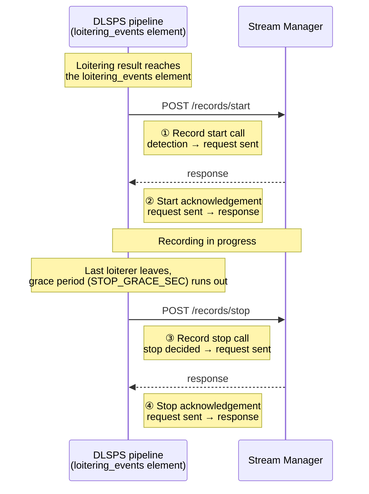

# Latency Measurements: Overview

A short summary of the latencies we will capture for loitering detection with Stream Manager.
The full design is in [latency-measurement.md](./latency-measurement.md).

## Why

WSF already reports pipeline throughput, stream density and pipeline latency. We add the
latencies of what happens after loitering is detected: starting and stopping a Stream Manager
recording, and the clip being saved.

## What we capture

The measurement points are the loitering result reaching the `loitering_events` element and the Stream Manager REST calls, so they stay
the same if the pipeline or the `loitering_events` element changes (for example when `gvapython` is replaced
by GStreamer Python bindings).



| # | Latency | From → To |
|---|---------|-----------|
| 1 | Record start call | Loitering result reaches the `loitering_events` element → `POST /records/start` sent |
| 2 | Record start acknowledgement | `POST /records/start` sent → response received |
| 3 | Record stop call | Stop decided (after the `STOP_GRACE_SEC` grace, 3 s by default) → `POST /records/stop` sent |
| 4 | Record stop acknowledgement | `POST /records/stop` sent → response received |

Arm latency = 1 + 2: how long after the loitering result is available the recording is set up.
It does not include the time the pipeline needed to produce that result (frame capture →
decode → detect → track → analytics), which the existing pipeline latency already reports. The recording still
includes the 5 s before detection, so a longer arm latency does not lose footage, as long as it
stays well within the Stream Manager buffer.

## Final E2E latency

The time from the first frame of the clip until the clip is saved in Stream Manager, compared
with the clip's own duration:

```text
Overhead (Δ) = E2E latency − clip duration
```

Example: a 50 s clip saved with a 50.5 s E2E latency has Δ = 500 ms. This is the overhead added
by Stream Manager ingest, the stop REST call and finalizing the clip.

## Other numbers reported

- Time from stopping a recording until the clip is ready to read (already included in the E2E overhead Δ; reported separately as a breakdown).
- Failed start/stop calls and retries.
- Stream Manager CPU, memory and disk use.
- Existing WSF KPIs (throughput, stream density, pipeline latency), re-run with Stream Manager on.

## Where we measure

| Source | Resolution | Streams |
|--------|-----------|---------|
| Simulated RTSP (looped videos) | 1280×720, 30 fps, H.264 | 1, 4, ... max supported without dropping below 30 fps |
| AXIS P3265-LVE camera (via MediaMTX) | 1280×720, 30 fps, H.264 | 1, 4, ... max supported without dropping below 30 fps (pipelines on the same camera) |

## Cloud (planned for 2027.0)

Stream Manager is planned to upload saved clips to the cloud. The feature does not exist yet,
so these are not measured now. Once available, we will measure:

- Clip saved → upload starts.
- Upload duration.
- Clip saved → visible in the cloud.
- Cloud E2E: first frame of the clip → visible in the cloud, compared with the clip duration.

Details are in section 6 of [latency-measurement.md](./latency-measurement.md).
