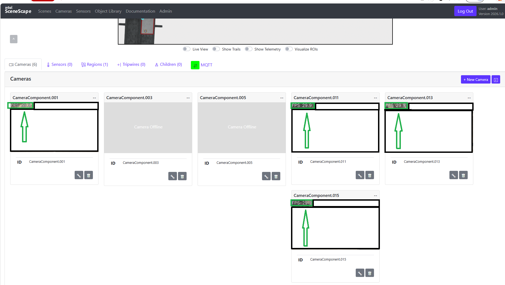

# Get Started

This guide provides step-by-step procedure to:

- Set up the agent using the automated setup script for quick deployment.
- Run predefined tasks to explore its functionality.
- Learn how to modify configurations to suit specific requirements.

## Prerequisites

Before you begin ensure the following:

- **System Requirements**: Verify that the system meets the
  [minimum requirements](./get-started/system-requirements.md).
- **Docker Installation Complete**: Install Docker, For installation instructions, see
  [Get Docker](https://docs.docker.com/get-docker/).

## Setup Guide

### 1. Deploy Source Code

Clone the suite to your Edge Server.
If you want to clone a specific release branch, replace `main` with the desired tag.
To learn more on partial cloning, check the [Repository Cloning guide](https://docs.openedgeplatform.intel.com/dev/OEP-articles/contribution-guide.html#repository-cloning-partial-cloning).

```bash
git clone --filter=blob:none --sparse --branch main https://github.com/open-edge-platform/metro-ai-suite.git
cd metro-ai-suite
git sparse-checkout set metro-vision-ai-app-recipe/
cd metro-vision-ai-app-recipe/
```

### 2. Configure the Environment

> [!NOTE]
> Verify variables in `.env` match your camera RTSP endpoints.

### 3. Create .yml file

Generate the 'docker-compose.yml' file:

```bash
./install.sh smart-tolling
```

### 4. Launch Services

Start the application stack using Docker Compose:

```bash
docker compose up -d
```

To **stop** the application:

```bash
docker compose down -v
```

### 5. Verify Deployment

Check the status of all containers:

```bash
docker compose ps
```

## Accessing the Application

Open a browser and go to the following endpoints. The application uses a self-signed HTTPS
certificate, so your browser will show a security warning - use **Google Chrome** and accept it.
After starting the stack, wait about a minute for the MQTT broker to come up before the UI shows
live data.

> [!NOTE]
> Passwords stored in secret files (e.g. `supass`, `influxdb2-admin-token`) are under
> `./smart-tolling/src/secrets/` (Docker) or `chart/files/secrets` (Helm).

### Scenescape Web UI

- **URL**: [https://localhost](https://localhost)
- **Username**: `admin`
- **Password**: Stored in `./smart-tolling/src/secrets/supass`



### Grafana UI

- **URL**: [https://localhost/grafana/](https://localhost/grafana/)
- **Username**: `admin`
- **Password**: You will be prompted to set one on first login.

### Node-RED UI

- **URL**: [https://localhost/nodered/](https://localhost/nodered/)

### InfluxDB UI

- **URL**: [http://localhost:8086](http://localhost:8086)
- **Username**: Stored in `./smart-tolling/src/secrets/influxdb2/influxdb2-admin-username`
- **Password**: Stored in `./smart-tolling/src/secrets/influxdb2/influxdb2-admin-password`

<!--hide_directive
:::{toctree}
:hidden:

./get-started/system-requirements

:::
hide_directive-->
